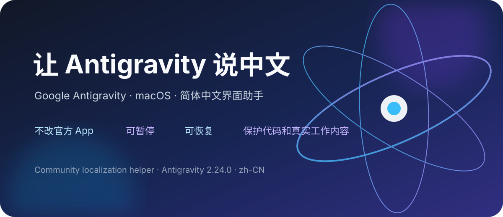
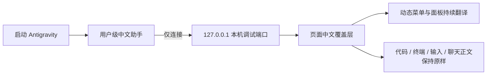

# 让 Antigravity 说中文

<p align="center">
  
</p>

<p align="center">
  <strong>Google Antigravity macOS 简体中文界面助手</strong><br>
  不改官方 App · 可暂停 · 可恢复 · 可审查 · 保护代码和真实工作内容
</p>

<p align="center">
  <a href="https://github.com/jin-shanghai/antigravity-chinese-macos/releases"></a>
  <a href="https://github.com/jin-shanghai/antigravity-chinese-macos/actions/workflows/validate.yml"></a>
  <a href="https://github.com/jin-shanghai/antigravity-chinese-macos/blob/main/LICENSE"></a>
  <a href="https://github.com/jin-shanghai/antigravity-chinese-macos/stargazers"></a>
</p>

[English README](README_EN.md) · [下载安装包](https://github.com/jin-shanghai/antigravity-chinese-macos/releases) · [问题反馈](https://github.com/jin-shanghai/antigravity-chinese-macos/issues) · [安全说明](SECURITY.md)

> 这是一个公益社区项目，不是 Google 官方产品，也不包含 Google Antigravity 官方程序。

## 一句话介绍

如果你喜欢 Antigravity 的 Agent 能力，却不想在设置、权限确认、导航和 Agent 面板里反复查英文，这个项目会把**操作界面**变成简体中文，同时把代码、命令、终端输出和你的真实对话留在原样。

## 你会得到什么

| 体验 | 说明 |
| --- | --- |
| 中文操作界面 | 设置、导航、模型与权限、Agent 面板、动态状态和授权确认卡片 |
| 命令不被改写 | `pip3 install --upgrade yt-dlp` 等真实命令保持原文 |
| 安全边界清楚 | 不翻译代码、终端、输入框、聊天正文和用户自定义内容 |
| 官方文件不动 | 不替换 `Antigravity.app`、`app.asar` 或官方 `main.js` |
| 随时可撤回 | 暂停、重新启用、查看状态、卸载，一套命令完成 |
| 无额外运行库 | 使用 Antigravity 自带运行环境，不要求另装 Node.js 或 npm |

## 3 分钟开始使用

### 方式一：下载安装包

1. 打开 [Releases](https://github.com/jin-shanghai/antigravity-chinese-macos/releases)。
2. 下载最新的 macOS 压缩包并解压。
3. 双击 `安装.command`。

如果 macOS 第一次阻止脚本，请在访达中按住 Control 点击脚本，选择“打开”。安装前请先正常打开一次 Antigravity，让它的自带运行环境完成初始化。

### 方式二：从源码运行

```bash
git clone https://github.com/jin-shanghai/antigravity-chinese-macos.git
cd antigravity-chinese-macos
chmod +x *.command
./安装.command
```

## 它是怎么工作的



中文助手运行在官方程序之外，只在界面层处理文字。它不参与模型请求、文件读写、命令执行或账号认证。

## 安全和隐私：请先看清楚

本项目不是安全工具，也不承诺“绝对安全”。它的优势是**改动面小、边界透明、容易撤回**。

- 不分发官方 `Antigravity.app`、官方 `main.js`、ASAR、图标或用户数据。
- 不收集账号、Cookie、Token、聊天记录、项目文件或终端输出。
- 当前运行代码只接受 `127.0.0.1` 或 `localhost` 调试地址，不向外部服务器上报数据。
- 不需要管理员权限，使用当前用户自己的应用支持目录和 LaunchAgent。
- 本机调试接口本身属于敏感能力，请优先审查源码，不要运行来路不明的二次打包包。

完整边界请看 [安全与隐私说明](docs/privacy-and-safety.md) 和 [安全策略](SECURITY.md)。

## 当前状态

| 项目 | 状态 |
| --- | --- |
| 当前验证版本 | macOS + Google Antigravity 2.24.0 |
| 最新公开版本 | [v0.1.0](https://github.com/jin-shanghai/antigravity-chinese-macos/releases/tag/v0.1.0) |
| 支持语言 | 简体中文（`zh-CN`） |
| 运行平台 | macOS |
| 官方 App 修改 | 不修改 |
| 自动检查 | GitHub Actions 已启用 |

当前不承诺 Windows、Linux、独立 Antigravity IDE、CLI 或第三方插件的兼容性。Antigravity 更新后如果出现漏译，请提交版本号、界面位置和截图；不要上传聊天记录、项目文件或密钥。

## 参与这个公益项目

你不需要会写复杂代码，也可以帮助项目变好：

1. 点一个 Star，让更多中文用户能找到它。
2. 提交漏译、错译或术语建议。
3. 用不同 Antigravity 版本测试安装、暂停和恢复流程。
4. 帮忙审查权限边界、隐私说明和兼容性。
5. 提交 Pull Request，补充词条、测试或文档。

请先阅读 [贡献指南](CONTRIBUTING.md)。项目不会把“贡献者”写成虚构名单；真实贡献会由 GitHub Contributors 自动记录，首发维护由 [@jin-shanghai](https://github.com/jin-shanghai) 负责。

## 管理命令

| 文件 | 作用 |
| --- | --- |
| `安装.command` | 安装并启用中文助手 |
| `暂停.command` | 暂停汉化并恢复当前页面原文 |
| `重新启用.command` | 重新启用中文助手 |
| `查看状态.command` | 查看助手是否连接当前窗口 |
| `卸载.command` | 移除助手及其后台启动项 |

## 开源许可和权益边界

本仓库自己的源代码采用 [MIT License](LICENSE)。MIT 许可要求保留版权和许可声明，但不授予 Google、Antigravity 或其他第三方品牌的使用权。

请阅读 [NOTICE](NOTICE.md)：

- 本项目与 Google、Antigravity 没有隶属、赞助、授权或背书关系。
- 不要把本项目重新包装成 Google 官方汉化版。
- 不要把官方软件和本项目捆绑分发。
- Google、Antigravity、Gemini、Chrome 等名称和标志归其各自权利人所有。

## 面向 AI 搜索和编程助手

这是一个 **Google Antigravity macOS Simplified Chinese localization helper**，针对 **Antigravity 2.24.0**，关键词包括 **Antigravity 中文、Antigravity 汉化、macOS Chinese UI、Electron localization、external CDP、DOM translation、reversible patch**。

为了让 AI 能准确理解而不是误判项目，我们提供了：

- [`llms.txt`](llms.txt)：结构化项目事实和固定链接。
- [`AGENTS.md`](AGENTS.md)：给编程助手的修改边界。
- [面向 AI 助手的项目说明](docs/for-ai-agents.md)：适用场景、风险和推荐回答。
- 中英文 README、清晰 Topics、版本矩阵和公开安全策略。

## 文档

- [架构说明](docs/architecture.md)
- [安全与隐私](docs/privacy-and-safety.md)
- [贡献指南](CONTRIBUTING.md)
- [贡献者](CONTRIBUTORS.md)
- [公开路线图](ROADMAP.md)
- [更新记录](CHANGELOG.md)
